<p align="center">
  
</p>

<p align="center">
  
</p>

<p align="center">
  <a href="https://www.linkedin.com/in/miguel-%C3%A1ngel-cano-salinas-803679376/"></a>
  
  
</p>

---

### About me

I turn messy data into decisions and repetitive work into automations. By day I'm a **Business Intelligence Analyst at Entirety LLC**; I also teach **Data Analytics in Estud-IA**, Medellín's public program with Universidad EAFIT.

```python
class MiguelAngel:
    location  = "Medellín, Colombia"
    roles     = ["BI Analyst @ Entirety LLC", "Data Analytics Professor @ Estud-IA (EAFIT)"]
    studying  = "B.S. Computer Science @ Universidad EAFIT · GPA 4.7/5.0"
    building  = ["AI agents", "data pipelines", "n8n & Make automations", "dashboards"]
    impact    = {"ai_agent_savings": "$8,000+ / month", "cost_reduction": "50%+"}
    languages = {"es": "native", "en": "B1"}
    offline   = ["street workout", "hiking"]
```

---

### Tech stack

<p align="center">
  <b>Languages</b><br><br>
  
</p>

<p align="center">
  <b>Data, AI &amp; automation</b><br><br>
  <br><br>
  
  
  
  
  
  
  
</p>

<p align="center">
  <b>Web</b><br><br>
  
</p>

<p align="center">
  <b>Cloud &amp; DevOps</b><br><br>
  
</p>

---

### Featured projects

<table>
  <tr>
    <td width="50%" valign="top">
      <h4><a href="https://github.com/stufonn-cell/accidentes_project_for_data_science">🚦 Road Accident Analytics</a></h4>
      Medallion data lake (bronze → silver → gold) over 13 years of Envigado open data, plus models that predict crashes with victims. ROC AUC <b>0.747</b>, tested on a 5M-row expansion, S3/Athena-ready.<br><br>
      
      
      
      
    </td>
    <td width="50%" valign="top">
      <h4><a href="https://github.com/stufonn-cell/webpage--sal1n4x">🧠 PsiClinic</a></h4>
      Clinical records platform for psychology practices: patient portal, psychometric tests with auto-scoring, ICD-11 coding and RIPS reports for Colombia's Ministry of Health.<br><br>
      
      
      
      
    </td>
  </tr>
  <tr>
    <td width="50%" valign="top">
      <h4><a href="https://github.com/stufonn-cell/Data_Science_Ethical_Scrapping">🔎 AI Image Research Platform</a></h4>
      Upload an image → OCR → an LLM identifies it → ethical web scraping → EDA and feature engineering, all in one Streamlit app.<br><br>
      
      
      
    </td>
    <td width="50%" valign="top">
      <h4><a href="https://github.com/stufonn-cell/TelematicP2">☁️ BookStore on AWS</a></h4>
      E-commerce monolith deployed on AWS with SSL and Nginx, scaled with autoscaling and ELB, then split into three microservices on Docker Swarm.<br><br>
      
      
      
    </td>
  </tr>
  <tr>
    <td width="50%" valign="top">
      <h4><a href="https://github.com/stufonn-cell/MoM-Project">📨 MoM Middleware</a></h4>
      Distributed message-oriented middleware: a routing tier balances load across three MOM instances with queues, topics, replication and partitioning.<br><br>
      
      
      
    </td>
    <td width="50%" valign="top">
      <h4><a href="https://github.com/stufonn-cell/compressing-descompressing-in-C">⚡ Parallel File Compressor</a></h4>
      File and folder compression in C, parallelized with OpenMP to use every core, with built-in timing to measure the speed-up.<br><br>
      
      
      
    </td>
  </tr>
</table>

---

### GitHub activity

<p align="center">
  
</p>

<p align="center">
  <picture>
    <source media="(prefers-color-scheme: dark)" srcset="https://raw.githubusercontent.com/stufonn-cell/stufonn-cell/output/github-contribution-grid-snake-dark.svg">
    <source media="(prefers-color-scheme: light)" srcset="https://raw.githubusercontent.com/stufonn-cell/stufonn-cell/output/github-contribution-grid-snake.svg">
    
  </picture>
</p>

<p align="center">
  
</p>
